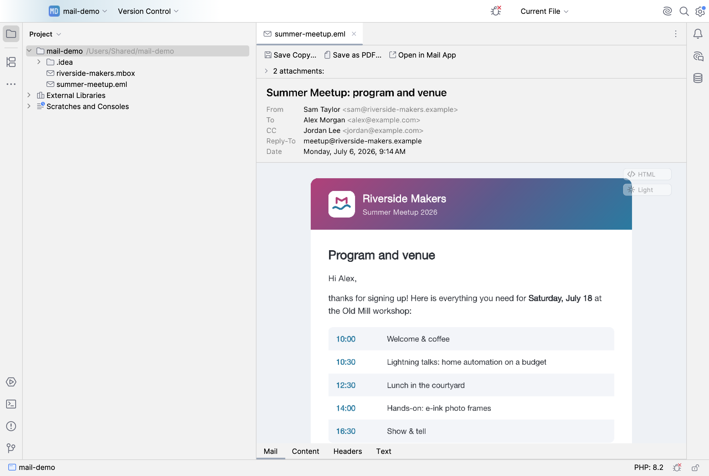

# Mail View


Plugin ID `app.heckit.ide.mailview` · Vendor heck\it ([heckit.app](https://heckit.app)) · [JetBrains Marketplace](https://plugins.jetbrains.com/plugin/35284-mail-view) · Source: https://github.com/phse/mail-view · Support: [GitHub Sponsors](https://github.com/sponsors/phse) or [Ko-fi](https://ko-fi.com/phse_de) · Feedback and feature requests: [plugin-mail-view@heckit.app](mailto:plugin-mail-view@heckit.app)



A plugin for JetBrains IDEs (PhpStorm, IntelliJ IDEA, … 2026.1 and later) that opens `.eml`,
Outlook `.msg`/`.oft`, Apple Mail `.emlx` and `.mht`/`.mhtml` files the way a mail client shows them. Tabs at the bottom of the editor, like
*Text | Data* for CSV files:

- **Mail** (default): subject, from, to, CC, BCC, reply-to and date, then the rendered message
  (HTML in an embedded browser, plain text otherwise). `cid:` images are embedded, remote content
  is blocked until *Load remote content* is clicked (*Always for example.com* trusts the sender's domain).
  Scripts never run. Links open in the system browser.
- **Attachments** are listed above the message (collapsed, click to expand), images with a thumbnail:
  click one to open it with the system application, *Save…* to store a copy.
- **HTML / Plain Text** and **Light / Dark** float at the top right of the message (faded until the mouse
  comes near) and show the active state. They scroll with the mail until they reach the top, then stay.
- **Content**: the decoded HTML or plain text part (switch at the top), read-only, highlighted.
- **Headers**: at the top the SPF, DKIM and DMARC badges, the sending software and *List-Unsubscribe* links, and the delivery path (Received chain from sender to recipient) with time and delay per hop; delays over 5 minutes are red. Below, all header lines of the mail, read-only, header names highlighted.
  For `.msg` these are the transport headers Outlook stores for received mails; drafts and sent
  mails have none.
- **Text**: the raw file in the regular editor, **read-only by default** (view and select only).
  *Edit* in the bar above unlocks it for this file until the IDE restarts; edits show up in the
  other tabs after a moment. Not for `.msg`/`.oft`: they are a binary format and have no *Text* tab.

Mails attached to a `.msg` are converted to `.eml` and open in Mail View again.

**winmail.dat** (Outlook TNEF): other mail clients only show this one file. Mail View lists the files inside
as normal attachments (under *From winmail.dat*) and shows the formatted text packed into it if the mail itself has no HTML part. A
`winmail.dat` (or `.tnef`) file opens on its own too. Test files: `test-data/hmef` in the Apache POI repository.

**.mbox / .mbx** (Thunderbird, Google Takeout, mailing list archives): the **Mails** tab lists attachments
(paperclip and count), sender, subject, date and size, sortable, with a search field (all words must appear in
sender, recipients or subject; the text icon inside the field also searches the mail text in the background).
Right-click the column header to show the *To* column. Column order, widths and sorting are remembered for all mbox files,
the last viewed mail per file. A click shows the mail
below the list; ↑/↓ (or the arrows above it) browse in list order. Double-click, Enter or *Open in Tab* opens
it as its own tab with all views. Mails are written to a temp folder as `.eml`; the mbox itself is never
changed. In the *Text* tab a line separates the mails (not in edit mode). Right-click mails to open them in a
tab, save them as `.eml` or save their attachments. The buttons next to the search field export the attachments
or all mails of the whole mbox into a folder. Existing files are never overwritten (`name (2).pdf`).

**Calendar invitations and contacts**: `.ics` and `.vcf` attachments get a line above the mail with the event
(title, time, place, organizer) or the contact (name, company, mail, phone), with *Open* and *Save…*.
**Find** (Cmd+F / Ctrl+F in the *Mail* tab) highlights matches in header and text; Enter / Shift+Enter jump
between them, Esc closes. **Save as PDF…** prints the mail as shown, always light. The *Headers* tab also shows
the **spam score** of SpamAssassin or rspamd as a badge.

**Open in Mail App** (bar above the mail) opens the mail in the default mail program; `.msg`/`.oft` and mails from
an mbox are handed over as `.eml`. There you can reply or forward with the program's own quoting and attachments.

Clicking an address in the mail header (it turns into a button on hover) offers *Add to Contacts…* (that one or all addresses of the mail),
*Copy Address* and *Write Mail*: Mail View writes a `.vcf` and opens it with the system address book, which
creates a new contact or updates an existing one.

**Save as .eml**: for `.msg`, `.oft` and `winmail.dat` the *Mail* tab offers *Save as .eml…* (converted with all
attachments, named after the file); in the mbox preview it saves the mail unchanged; for `.eml` files it is *Save
Copy…*.
**Settings** (*Settings | Tools | Mail View*, also in the right-click menus): appearance on open (last used, IDE
theme, light, dark), start tab or the last tab per file, plain text instead of HTML, remote content (never, from
trusted senders, always), expanded attachment list, reveal unknown attachments instead of opening them. The
right-click menus only offer *Copy* and the settings instead of the browser or full editor menu.

The mbox file is streamed once and only the headers are read, so archives of several GB work too.

The plugin never writes to the mail file itself; only the unlocked *Text* tab can change an `.eml`.
The UI is available in English and German.

## Installation

In the IDE, go to *Settings | Plugins | Marketplace* and search for **Mail View**, or use the
[Marketplace page](https://plugins.jetbrains.com/plugin/35284-mail-view). Bugs and ideas are
welcome as [GitHub issues](https://github.com/phse/mail-view/issues).

## Build and run

Gradle needs JDK 17 or later. The toolchain (JDK 25) is downloaded by Gradle via foojay if needed.

```
./gradlew runIde        # start a sandbox IDE with the plugin
./gradlew buildPlugin   # build/distributions/mail-view-<version>.zip
./gradlew test          # unit tests
```

Verify against the local IDE and the oldest supported version (`verifyOldestVersion`):

```
./gradlew verifyPlugin
```

Options (`-P…`):

- `openProject=/path/to/project` opens a project in the sandbox right away
- `samples=<folder with .eml/.msg>` (with `test`) parses real mails and prints their parts or the error.
  Good `.msg` test files: `test-data/hsmf` in the [Apache POI](https://github.com/apache/poi) repository.

Install a self-built ZIP: *Settings | Plugins | ⚙ | Install Plugin from Disk…*

By default Gradle downloads PhpStorm `platformVersion` (from `gradle.properties`) as the target
platform. With an installed IDE it's faster: create `local.properties` (not checked in) containing
e.g.

```
platformLocalPath=/Applications/PhpStorm.app
```

## Publishing (JetBrains Marketplace)

The Marketplace description lives in `src/main/resources/META-INF/plugin.xml`, the change notes in
`build.gradle.kts`, the icon in `META-INF/pluginIcon.svg` (light theme) and `pluginIcon_dark.svg`
(dark theme). The IDE and the Marketplace read the icon straight from the ZIP, it doesn't have to be
uploaded separately. `marketplace/plugin-icon.png` at the top of this README is a preview of both.

1. Bump the version in `gradle.properties`, add change notes.
2. `./gradlew clean buildPlugin verifyPlugin` (fix any deprecated API it reports before releasing)
3. `PUBLISH_TOKEN=… ./gradlew publishPlugin` with a token from
   https://plugins.jetbrains.com/author/me/tokens (or `jetbrainsMarketplaceToken=…` in
   `~/.gradle/gradle.properties`), or upload the ZIP from `build/distributions/` by hand on the
   [Marketplace page](https://plugins.jetbrains.com/plugin/35284-mail-view). JetBrains reviews
   every version before it is released.
4. Tag the commit (`git tag v<version>`) and push.

Signing is optional (variables `CERTIFICATE_CHAIN`, `PRIVATE_KEY`, `PRIVATE_KEY_PASSWORD`,
see https://plugins.jetbrains.com/docs/intellij/plugin-signing.html).

## Regenerating the screenshots

```
./gradlew runIde -Pscreenshots=marketplace/screenshots
```

Copies `marketplace/demo-project` to `/Users/Shared/mail-demo` (so no user path shows up in the
images), opens it in the sandbox and writes six PNGs to `marketplace/screenshots/` (mail, attachments,
content tab, dark theme, headers tab, mbox list). The IDE paints its own window for this, no screen recording permission is
needed. The helper lives in `src/screenshot/` and is only compiled with `-Pscreenshots`, never into a
release. Close any running sandbox first, and close the sandbox afterwards.

If the sandbox asks on the first run, confirm "Trust Project" once and run the command again.

## How it works

| File | Contents |
| --- | --- |
| `EmlFileType.kt` | File types `.eml` (text, so the regular editor shows the raw data) and `.msg` (binary), icon |
| `MailParser.kt` | MIME parsing with Jakarta/Angus Mail (headers, HTML/text part, inline images, attachments); hands `.msg` to `MsgParser` |
| `MsgParser.kt` | Outlook `.msg` (MS-OXMSG): properties, recipients, attachments, codepages, RTF-only bodies via `rtf-to-html` |
| `CfbReader.kt` | Read-only reader for the OLE2 container of `.msg` (MS-CFB: FAT, DIFAT, mini stream, directory) |
| `CompressedRtf.kt` | Decompresses the RTF body of `.msg` (MS-OXRTFCP, LZFu) |
| `MailSource.kt` | Parses in the background and again after edits (unsaved document or file bytes) |
| `MailHtmlRenderer.kt` | HTML page of the *Mail* tab: header, message in a sandboxed iframe, CSP, dark display |
| `MailPreviewEditor.kt` | *Mail* tab (JCEF), scrolling, remote content banner, attachments, *Dark* switch |
| `MailViewSettings.kt` | Settings shared by all projects (dark display) |
| `MailContentEditor.kt` | *Content* tab (read-only editor, HTML/Text switch) |
| `MailHeaderEditor.kt` | *Headers* tab (read-only editor) |
| `MailEditMode.kt` | Read-only by default, edit mode per file, bar above the *Text* tab |
| `MailEditorProviders.kt` | Registers the tabs before the regular editor |
| `MailViewBundle.kt` | UI texts (English, German) in `resources/messages/` |

Since 2026.x JCEF always renders off-screen, and scrolling inside Chromium stutters then. The page
therefore reports its height, the browser gets the full height and a regular Swing scroll pane
scrolls, like in the other tabs. Very long mails (over 8000 px) scroll inside Chromium to keep the
off-screen buffer small.

`getContent()` of Jakarta Mail is avoided on purpose: it needs Jakarta Activation's mailcap
registry, which doesn't work reliably in a plugin class loader. Multiparts are read via
`MimePartDataSource`, text parts as decoded bytes with their charset.

`.msg` is read without Apache POI: the plugin only needs the OLE2 container and the RTF
decompression, both openly documented by Microsoft. POI would add about 7 MB for that.

## License

Apache License 2.0, see [`LICENSE`](LICENSE) and [`NOTICE`](NOTICE).
Copyright 2026 Peter Heck (heck\it). The name and logo are not covered by the license.
